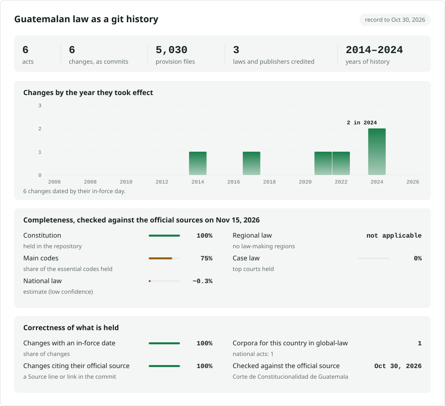

# Guatemala: law history in git

[Español](README.md) · **English**

<picture>
<source media="(prefers-color-scheme: dark)" srcset="data/effort-dark.svg">

</picture>

The law of Guatemala as a git history: one file per article, one commit per version on the day in its `In-force:` trailer, and the act or publisher behind each version as the commit's author. Guatemala's official publishers put each act online as one edition with its reforms already applied, and no earlier texts, so each act here has one version for now, credited to its publisher; a newer text goes on top as a new commit, and `git log` and `git blame` then show what changed. Picking a date gives the text this record holds that day.

Part of [lexifina/global-law](https://github.com/lexifina/global-law), one git history for every country's law: this is Guatemala's national law, which global-law reads at `guatemala/national/acts/`.

**What is in it now:** the Constitution and five codes (the Código Penal, Código Civil, Código de Comercio, Código de Trabajo and Código Procesal Penal), 5,024 provisions in all, each act in one version. [`data/versions.json`](data/versions.json) gives each act's source and the sha256 of the file it was read from; each act's own `README.md` lists its provisions.

Each act is a folder with one file per article: the Constitution is `constitution/constitucion/` and the codes are in `code/` (`code/codigo-de-trabajo/art-130.md` is Article 130 of the Código de Trabajo, Decreto 1441, on paid annual leave). Transitional and final provisions are the `disp-`, `trans-` and `fin-` files, and the Constitution's headings are its `tit-` files. [`data/paths.json`](data/paths.json) maps each act id to its folder.

The text is in Spanish, the official language, as each edition prints it. An English translation is not part of this record.

## Questions as git commands

| Question | Command |
| --- | --- |
| Every change to Article 130 of the Código de Trabajo | `git log -p --word-diff --follow -- code/codigo-de-trabajo/art-130.md` |
| Which act wrote each line of Article 130? | `git blame code/codigo-de-trabajo/art-130.md` |
| Every version of the Código de Trabajo, with the day of each | `git log --diff-filter=r --format="%h %(trailers:key=In-force,valueonly,separator=) %an" -- code/codigo-de-trabajo codigo-de-trabajo ":^*/README.md"` |
| Article 130 as held on 1 January 2020 | `python tools/on.py 2020-01-01 code/codigo-de-trabajo art-130` |

On 2026-11-10 the acts moved to their present folders: `--follow` and the old folder name (`codigo-de-trabajo`) reach the history before the move, and `--diff-filter=r` leaves the move itself out.

**Outside git**, we also host this record publicly, for free:

- **[Ask Claude about Guatemalan law](https://global-law.lexifina.com/v1/try_claude?country=guatemala)**: opens Claude with a first question ready.
- **[Ask ChatGPT](https://global-law.lexifina.com/v1/try_chatgpt?country=guatemala)**: the same question in ChatGPT.
- **[Search Guatemalan law on our site](https://lexifina.com/law?country=guatemala&q=vacaciones)**: a search for "vacaciones" (paid leave), with each provision's text and its versions, no account needed.
- **[Developer REST API](https://global-law.lexifina.com/v1/search_law?query=vacaciones&jurisdiction=guatemala)**: the same search as JSON, with no key. See the [documentation here](https://lexifina.com/api/global-law).

Both assistants read the record through the free Global law connector (MCP, `https://global-law.lexifina.com/mcp`); the first time, the chat gives you the link that adds it. Ask in Spanish or in English.

**Host it yourself easily.** All it takes is git and Python, and the tools run on your machine:

```sh
git clone --depth 1 https://github.com/lexifina/global-law && cd global-law
python3 tools/countries.py add guatemala/national/acts
python3 tools/law.py show 2026-01-01 guatemala/national/acts/code/codigo-de-trabajo/art-130.md
```

Opened in Claude Code, Cursor, VS Code or Codex, the clone also starts a local MCP server with the same tools ([MCP.md](https://github.com/lexifina/global-law/blob/main/MCP.md)).

## Dates

Each commit is dated at noon, America/Guatemala, on the day in its `In-force:` trailer. With one edition per act, that day is the edition's, not the day the act first took effect (the Constitution's was 14 January 1986):

- the date of the PDF for the Constitution (18 July 2024), the Código Civil (21 June 2024), the Código Penal (11 August 2022) and the Código de Comercio (23 April 2021);
- the day the edition says it is updated to for the Código Procesal Penal (30 April 2014);
- for the Código de Trabajo, the day its latest reform, Decreto 7-2017, took effect: 14 April 2017, eight days after its publication on 6 April 2017 (Ley del Organismo Judicial, art. 6).

Each version is credited to a publisher as the "oldest version available": the Código de Trabajo to the Oficina Nacional de Servicio Civil, the Código Procesal Penal to CENADOJ (Organismo Judicial), and the other four to the Corte de Constitucionalidad, the repository's default publisher, although only the Constitution is its edition (see Sources). The committer is Lexifina.

## How it is checked

- `tools/check_repo.py` reads every version back from git on the day it took effect and on the day before, and compares it with the corpus: 6 versions of 6 acts, 0 mismatches.
- A second build from the same corpus gave identical hashes for all 6 law commits and 6 tags; the corpus's sha256 and the builder's hashes are in [`REPRODUCE.md`](REPRODUCE.md), with every decision made by hand.
- About half the lines of the Constitution's PDF use a font with no Unicode map; they were decoded with a fixed glyph table (not OCR), and every word was checked against the PDF's normally encoded lines.
- Every commit's trailers parse; there are no merge commits, no commit dates that go backwards and none after the build.

## What it does not show

- **Reforms after each edition.** The Código Penal is a consolidation of about 2008; the Código Procesal Penal stops at Decreto 6-2013 (Decreto 10-2019, for example, is not applied), the Código de Trabajo at Decreto 7-2017, the Código de Comercio at Decreto 20-2018, and the Código Civil at an unstated date.
- **Earlier texts, and which decree made each change.** No source gives past versions, so `git blame` names the publisher, not the reforming decree; the Constitution includes the 1993 reforms, but its footnotes naming them are left out.
- **The editors' matter.** Reform footnotes and notes, the codes' book, title and chapter headings, considerandos and signatures are left out; the Código de Comercio keeps its source's reform notes in braces, and the Código Procesal Penal's repealed articles read "Derogado.".
- **The rest of Guatemala's law.** Other decrees of the Congress, regulations and court decisions are not here.

## Sources

| Source | Kind | Past versions | Notes |
| --- | --- | --- | --- |
| [Corte de Constitucionalidad](https://www.cc.gob.gt/index.php/constitucion-politica/) | Constitución Política de la República, 2024 edition | no | With the 1993 reforms |
| [Instituto de la Defensa Pública Penal](https://www.idpp.gob.gt/images/Biblioteca-virtual/Leyes_y_Reglamentos/CODIGO_PENAL.pdf) | Código Penal (Decreto 17-73), with its reforms | no | A consolidation of about 2008 |
| [Ministerio de Cultura y Deportes](https://mcd.gob.gt/wp-content/uploads/2013/07/codigo-civil.pdf) | Código Civil (Decreto-Ley 106), with its reforms | no | Reforms to an unstated date |
| [Ministerio de Economía](https://portal.mineco.gob.gt/sites/default/files/Mineco/ley_-_codigo_de_comercio_decreto_2-70_-_02-11-1970.pdf) | Código de Comercio (Decreto 2-70), with its reforms | no | Reforms to Decreto 20-2018 |
| [Oficina Nacional de Servicio Civil](https://www.amsclae.gob.gt/wp-content/uploads/2026/08/10.-DECRETO-1441-CODIGO-DE-TRABAJO.pdf) | Código de Trabajo (Decreto 1441), consolidated | no | Reforms to Decreto 7-2017; the edition on the AMSCLAE website |
| [CENADOJ, Organismo Judicial](https://portal.pnc.edu.gt/wp-content/uploads/2024/02/CODIGO-PROCESAL-PENAL.pdf) | Código Procesal Penal (Decreto 51-92), with its reforms | no | Updated to 30 April 2014; the edition on the Academia de la Policía Nacional Civil's website, read from an Internet Archive copy of 3 June 2024 |

## Licence

See [`LICENSE`](LICENSE). The sources state no licence; the texts are reproduced as official legal texts, with attribution to the bodies that published them (the CENADOJ edition reads "Derechos reservados: Organismo Judicial de Guatemala", and only its text of the law is reproduced). Lexifina's arrangement, tables, commit messages and tools may be reused under CC BY 4.0.

No AI model wrote, translated or corrected legal text, and none runs when the history is built; the scripts were written by Claude Code running Claude Opus 5.5 (see [`REPRODUCE.md`](REPRODUCE.md)).

## More

From [lexifina/global-law](https://github.com/lexifina/global-law):

- [FEATURES.md](https://github.com/lexifina/global-law/blob/main/FEATURES.md): every feature, and what every corpus must support (`git blame`, `law.py`, the MCP tools)
- [FAQ.md](https://github.com/lexifina/global-law/blob/main/FAQ.md): questions and answers · [CONTRIBUTING.md](https://github.com/lexifina/global-law/blob/main/CONTRIBUTING.md): proposing changes · [MCP.md](https://github.com/lexifina/global-law/blob/main/MCP.md): the MCP server · [REPRODUCE.md](https://github.com/lexifina/global-law/blob/main/REPRODUCE.md): how it was built · [CHANGELOG.md](https://github.com/lexifina/global-law/blob/main/CHANGELOG.md)
- [FRESHNESS.md](https://github.com/lexifina/global-law/blob/main/FRESHNESS.md): how current each corpus is · [Monitoring](https://github.com/lexifina/global-law/tree/main/monitoring): whether updates are running · [WATCHING.md](https://github.com/lexifina/global-law/blob/main/WATCHING.md): how each official source is watched for changes
- [performance/](https://github.com/lexifina/global-law/tree/main/performance): how fast the tools are, measured
- [visualisations/](https://github.com/lexifina/global-law/tree/main/visualisations): charts and bridges across the world's law
- [Vulnerabilities](https://github.com/lexifina/global-law/tree/main/vulnerabilities): mistakes in legislation as published
