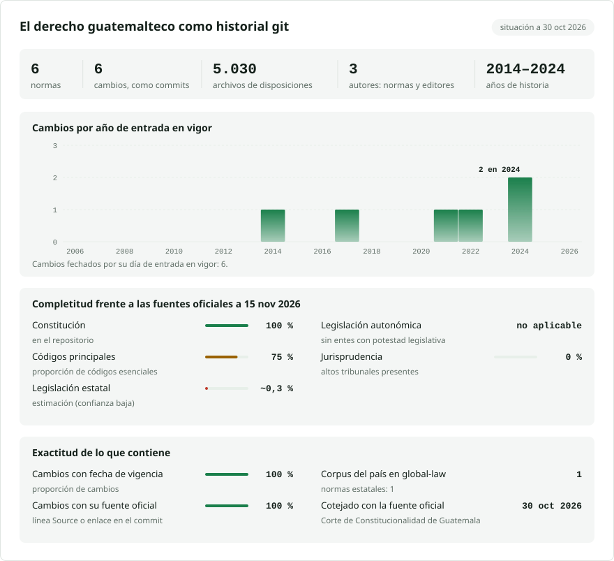

# Guatemala: historia del derecho en git

**Español** · [English](README.en.md)

<picture>
<source media="(prefers-color-scheme: dark)" srcset="data/es/effort-dark.svg">

</picture>

El derecho de Guatemala como historia de git: un archivo por artículo, un commit por versión en el día que indica su trailer `In-force:`, y la norma o la entidad editora que está detrás de cada versión como autor del commit. Las entidades oficiales que publican las normas de Guatemala ponen en línea cada norma como una sola edición con sus reformas ya incorporadas, y sin textos anteriores, por lo que cada norma tiene aquí, por ahora, una sola versión, atribuida a quien la publica; un texto más reciente se añade encima como un nuevo commit, y entonces `git log` y `git blame` muestran qué cambió. Al elegir una fecha se obtiene el texto que este registro contiene ese día.

Forma parte de [lexifina/global-law](https://github.com/lexifina/global-law), una única historia de git para el derecho de todos los países: este es el derecho nacional de Guatemala, que global-law lee en `guatemala/national/acts/`.

**Qué contiene ahora:** la Constitución y cinco códigos (el Código Penal, el Código Civil, el Código de Comercio, el Código de Trabajo y el Código Procesal Penal), 5024 disposiciones en total, cada norma en una versión. [`data/versions.json`](data/versions.json) indica la fuente de cada norma y el sha256 del archivo del que se leyó; el `README.md` propio de cada norma enumera sus disposiciones.

Cada norma es una carpeta con un archivo por artículo: la Constitución está en `constitution/constitucion/` y los códigos en `code/` (`code/codigo-de-trabajo/art-130.md` es el Artículo 130 del Código de Trabajo, Decreto 1441, sobre las vacaciones anuales remuneradas). Las disposiciones transitorias y finales son los archivos `disp-`, `trans-` y `fin-`, y los encabezados de la Constitución son sus archivos `tit-`. [`data/paths.json`](data/paths.json) relaciona el identificador de cada norma con su carpeta.

El texto está en español, el idioma oficial, tal como lo publica cada edición. Este registro no incluye una traducción al inglés.

## Preguntas como comandos de git

| Pregunta | Comando |
| --- | --- |
| Todos los cambios del Artículo 130 del Código de Trabajo | `git log -p --word-diff --follow -- code/codigo-de-trabajo/art-130.md` |
| ¿Qué norma escribió cada línea del Artículo 130? | `git blame code/codigo-de-trabajo/art-130.md` |
| Todas las versiones del Código de Trabajo, con el día de cada una | `git log --diff-filter=r --format="%h %(trailers:key=In-force,valueonly,separator=) %an" -- code/codigo-de-trabajo codigo-de-trabajo ":^*/README.md"` |
| El Artículo 130 tal como consta en el registro al 1 de enero de 2020 | `python tools/on.py 2020-01-01 code/codigo-de-trabajo art-130` |

El 2026-11-10 las normas pasaron a sus carpetas actuales: `--follow` y el nombre anterior de la carpeta (`codigo-de-trabajo`) alcanzan la historia anterior al traslado, y `--diff-filter=r` deja fuera el propio traslado.

**Fuera de git**, también alojamos este registro de forma pública y gratuita:

- **[Preguntar a Claude sobre el derecho guatemalteco](https://global-law.lexifina.com/v1/try_claude?country=guatemala)**: abre Claude con una primera pregunta preparada.
- **[Preguntar a ChatGPT](https://global-law.lexifina.com/v1/try_chatgpt?country=guatemala)**: la misma pregunta en ChatGPT.
- **[Buscar en el derecho guatemalteco en nuestro sitio](https://lexifina.com/law?country=guatemala&q=vacaciones)**: una búsqueda de "vacaciones", con el texto de cada disposición y sus versiones, sin necesidad de cuenta.
- **[API REST para desarrolladores](https://global-law.lexifina.com/v1/search_law?query=vacaciones&jurisdiction=guatemala)**: la misma búsqueda en JSON, sin clave. Consulte la [documentación aquí](https://lexifina.com/api/global-law).

Ambos asistentes leen el registro a través del conector gratuito Global law (MCP, `https://global-law.lexifina.com/mcp`); la primera vez, el chat le da el enlace para agregarlo. Pregunte en español o en inglés.

**Alójelo usted mismo fácilmente.** Solo hacen falta git y Python, y las herramientas se ejecutan en su equipo:

```sh
git clone --depth 1 https://github.com/lexifina/global-law && cd global-law
python3 tools/countries.py add guatemala/national/acts
python3 tools/law.py show 2026-01-01 guatemala/national/acts/code/codigo-de-trabajo/art-130.md
```

Abierto en Claude Code, Cursor, VS Code o Codex, el clon también inicia un servidor MCP local con las mismas herramientas ([MCP.md](https://github.com/lexifina/global-law/blob/main/MCP.md)).

## Fechas

Cada commit está fechado a las doce del mediodía, hora de America/Guatemala, del día que indica su trailer `In-force:`. Con una sola edición por norma, ese día es el de la edición, no el día en que la norma entró en vigor por primera vez (el de la Constitución fue el 14 de enero de 1986):

- la fecha del PDF para la Constitución (18 de julio de 2024), el Código Civil (21 de junio de 2024), el Código Penal (11 de agosto de 2022) y el Código de Comercio (23 de abril de 2021);
- el día hasta el cual la edición dice estar actualizada para el Código Procesal Penal (30 de abril de 2014);
- para el Código de Trabajo, el día en que entró en vigor su última reforma, el Decreto 7-2017: el 14 de abril de 2017, ocho días después de su publicación el 6 de abril de 2017 (Ley del Organismo Judicial, art. 6).

Cada versión se atribuye a una entidad editora como "versión más antigua disponible": el Código de Trabajo a la Oficina Nacional de Servicio Civil, el Código Procesal Penal al CENADOJ (Organismo Judicial) y los otros cuatro a la Corte de Constitucionalidad, la entidad editora predeterminada del repositorio, aunque solo la Constitución es edición suya (véase Fuentes). El committer es Lexifina.

## Cómo se verifica

- `tools/check_repo.py` vuelve a leer desde git cada versión el día en que entró en vigor y el día anterior, y la compara con el corpus: 6 versiones de 6 normas, 0 discrepancias.
- Una segunda compilación a partir del mismo corpus dio hashes idénticos para los 6 commits de normas y las 6 etiquetas; el sha256 del corpus y los hashes del compilador están en [`REPRODUCE.md`](REPRODUCE.md), junto con cada decisión tomada a mano.
- Cerca de la mitad de las líneas del PDF de la Constitución usan una fuente tipográfica sin mapa Unicode; se decodificaron con una tabla fija de glifos (no con OCR), y cada palabra se cotejó con las líneas del PDF codificadas normalmente.
- Los trailers de todos los commits se analizan sin errores; no hay commits de fusión (merge), ni fechas de commit que retrocedan, ni ninguna posterior a la compilación.
- [vulnerabilities/](vulnerabilities/): posibles errores de redacción en este derecho, hallados por los detectores de global-law y revisados a mano. Aún no se ha ejecutado.

## Qué no muestra

- **Las reformas posteriores a cada edición.** El Código Penal es una compilación de alrededor de 2008; el Código Procesal Penal llega hasta el Decreto 6-2013 (no se aplica, por ejemplo, el Decreto 10-2019), el Código de Trabajo hasta el Decreto 7-2017, el Código de Comercio hasta el Decreto 20-2018, y el Código Civil hasta una fecha no indicada.
- **Los textos anteriores y qué decreto hizo cada cambio.** Ninguna fuente da versiones anteriores, por lo que `git blame` indica la entidad editora, no el decreto de reforma; la Constitución incluye las reformas de 1993, pero se omiten sus notas al pie que las mencionan.
- **El material de los editores.** Se omiten las notas al pie de reforma y las notas, los encabezados de libros, títulos y capítulos de los códigos, los considerandos y las firmas; el Código de Comercio conserva entre llaves las notas de reforma de su fuente, y los artículos derogados del Código Procesal Penal dicen "Derogado.".
- **El resto del derecho de Guatemala.** No están aquí los demás decretos del Congreso, los reglamentos ni las resoluciones judiciales.

## Fuentes

| Fuente | Tipo | Versiones anteriores | Notas |
| --- | --- | --- | --- |
| [Corte de Constitucionalidad](https://www.cc.gob.gt/index.php/constitucion-politica/) | Constitución Política de la República, edición de 2024 | no | Con las reformas de 1993 |
| [Instituto de la Defensa Pública Penal](https://www.idpp.gob.gt/images/Biblioteca-virtual/Leyes_y_Reglamentos/CODIGO_PENAL.pdf) | Código Penal (Decreto 17-73), con sus reformas | no | Una compilación de alrededor de 2008 |
| [Ministerio de Cultura y Deportes](https://mcd.gob.gt/wp-content/uploads/2013/07/codigo-civil.pdf) | Código Civil (Decreto-Ley 106), con sus reformas | no | Reformas hasta una fecha no indicada |
| [Ministerio de Economía](https://portal.mineco.gob.gt/sites/default/files/Mineco/ley_-_codigo_de_comercio_decreto_2-70_-_02-11-1970.pdf) | Código de Comercio (Decreto 2-70), con sus reformas | no | Reformas hasta el Decreto 20-2018 |
| [Oficina Nacional de Servicio Civil](https://www.amsclae.gob.gt/wp-content/uploads/2026/08/10.-DECRETO-1441-CODIGO-DE-TRABAJO.pdf) | Código de Trabajo (Decreto 1441), con sus reformas incorporadas | no | Reformas hasta el Decreto 7-2017; la edición del sitio web de la AMSCLAE |
| [CENADOJ, Organismo Judicial](https://portal.pnc.edu.gt/wp-content/uploads/2024/02/CODIGO-PROCESAL-PENAL.pdf) | Código Procesal Penal (Decreto 51-92), con sus reformas | no | Actualizado al 30 de abril de 2014; la edición del sitio web de la Academia de la Policía Nacional Civil, leída de una copia de Internet Archive del 3 de junio de 2024 |

## Licencia

Véase [`LICENSE`](LICENSE). Las fuentes no indican ninguna licencia; los textos se reproducen como textos jurídicos oficiales, con atribución a las entidades que los publicaron (la edición del CENADOJ dice "Derechos reservados: Organismo Judicial de Guatemala", y de ella solo se reproduce el texto de la ley). La organización, las tablas, los mensajes de commit y las herramientas de Lexifina pueden reutilizarse conforme a CC BY 4.0.

Ningún modelo de IA escribió, tradujo ni corrigió texto normativo, y ninguno se ejecuta cuando se construye la historia; los scripts los escribió Claude Code con Claude Opus 5.5 (véase [`REPRODUCE.md`](REPRODUCE.md)).

Esta es una traducción de la versión inglesa ([README.en.md](README.en.md)); si difieren, prevalece la versión inglesa.

## Visualizaciones

- [visualisations/](visualisations/): gráficos hechos a partir de este repositorio. Aún no se han hecho.

## Más información

Del repositorio [lexifina/global-law](https://github.com/lexifina/global-law) (páginas en inglés):

- [FEATURES.md](https://github.com/lexifina/global-law/blob/main/FEATURES.md): todas las funciones y lo que cada corpus debe admitir (`git blame`, `law.py`, herramientas MCP)
- [FAQ.md](https://github.com/lexifina/global-law/blob/main/FAQ.md): preguntas y respuestas · [CONTRIBUTING.md](https://github.com/lexifina/global-law/blob/main/CONTRIBUTING.md): proponer cambios · [MCP.md](https://github.com/lexifina/global-law/blob/main/MCP.md): servidor MCP · [REPRODUCE.md](https://github.com/lexifina/global-law/blob/main/REPRODUCE.md): cómo se ha construido · [CHANGELOG.md](https://github.com/lexifina/global-law/blob/main/CHANGELOG.md)
- [FRESHNESS.md](https://github.com/lexifina/global-law/blob/main/FRESHNESS.md): lo actualizado que está cada corpus · [Supervisión](https://github.com/lexifina/global-law/tree/main/monitoring): si las actualizaciones funcionan · [WATCHING.md](https://github.com/lexifina/global-law/blob/main/WATCHING.md): cómo se vigila cada fuente oficial para detectar cambios
- [performance/](https://github.com/lexifina/global-law/tree/main/performance): la rapidez de las herramientas, medida
- [visualisations/](https://github.com/lexifina/global-law/tree/main/visualisations): gráficos y conexiones a través del derecho de todo el mundo
- [Vulnerabilidades](https://github.com/lexifina/global-law/tree/main/vulnerabilities): errores en las normas tal como se publicaron
